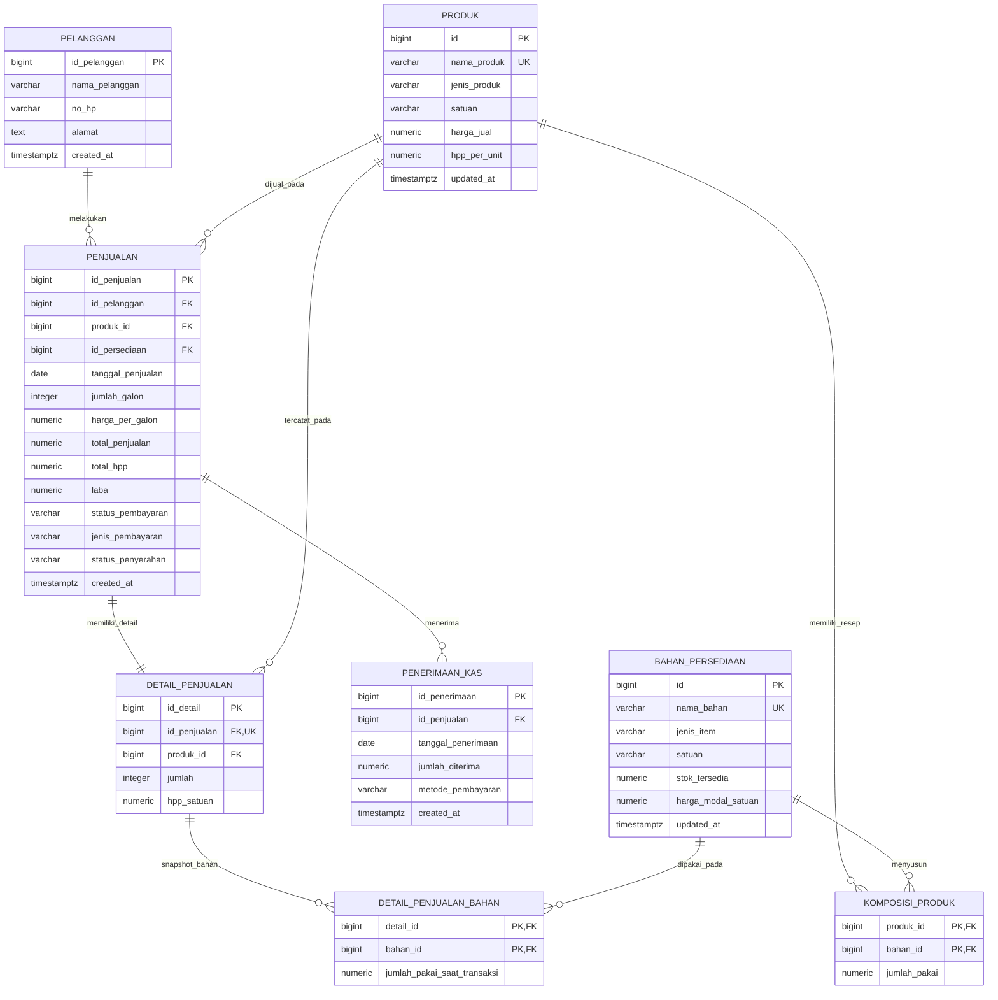

# 💧 Sistem Depot Air Minum

Sistem Depot Air Minum adalah aplikasi berbasis web untuk membantu pengelolaan **penjualan, penerimaan kas, piutang, penyerahan barang, pelanggan, katalog produk, serta bahan persediaan dan perhitungan Harga Pokok Penjualan (HPP)** pada usaha depot air minum.

Aplikasi menggunakan **HTML, CSS, dan JavaScript** pada frontend serta **Supabase PostgreSQL** (termasuk **Supabase Auth**, **Realtime**, **Database Triggers**, **Views**, dan **RPC**) sebagai backend.

🔗 **Demo:**
[https://cahayakamila44-sudo.github.io/Aplikasi-Sistem-Depot-Air/](https://cahayakamila44-sudo.github.io/Aplikasi-Sistem-Depot-Air/)

Username: cahayakamila77

Password: 654321

---

## Teknologi

| **Bagian**      | **Teknologi**                                                      |
| --------------- | ------------------------------------------------------------------ |
| Frontend        | HTML, CSS, JavaScript murni (tanpa framework)                      |
| Backend         | [Supabase](https://supabase.com/) (PostgreSQL, Auth, Realtime)     |
| Koneksi         | `supabase-js` v2 melalui CDN                                       |
| Konfigurasi     | `config.js` untuk konfigurasi koneksi Supabase & autentikasi       |
| Logika Aplikasi | `apps.js` untuk menjalankan fungsi utama sistem                    |
| Tampilan        | CSS custom dan ikon [Font Awesome](https://fontawesome.com/) 6.5.2 |
| Hosting         | [GitHub Pages](https://pages.github.com/)                          |

---

## Fitur

| **Menu / Modul**      | **Isi & Fungsi Utama**                                                                                                                                                                                                    |
| --------------------- | ------------------------------------------------------------------------------------------------------------------------------------------------------------------------------------------------------------------------- |
| **Dashboard**         | Ringkasan total pelanggan, total transaksi, total penjualan, total penerimaan kas, total stok galon, sisa piutang, laba transaksi, serta pemantauan stok bahan/produk secara *realtime*                                   |
| **Penjualan**         | Form transaksi penjualan (Tunai/Kredit), data pelanggan, pemilihan barang/produk (`isi_ulang` / `pabrikan`), jumlah galon, harga per galon, total transaksi, `total_hpp`, `laba`, status pembayaran, dan status penyerahan |
| **Penerimaan Kas**    | Pencatatan pembayaran berdasarkan transaksi penjualan (Tunai otomatis maupun cicilan/pelunasan piutang melalui fungsi atomik `fn_catat_penerimaan`), tanggal penerimaan, jumlah diterima, serta metode pembayaran (`Tunai`, `Transfer`, atau `QRIS`) dengan sinkronisasi status otomatis |
| **Piutang**           | Pemantauan daftar transaksi `Belum Lunas`, total tagihan, total dibayar, dan `sisa_piutang` melalui database view `v_piutang`                                                                                             |
| **Penyerahan Barang** | Pelacakan status distribusi barang (`Belum Diserahkan` / `Sudah Sampai`) beserta status pelunasannya melalui database view `v_penyerahan_barang`                                                                         |
| **Persediaan & HPP**  | Pengelolaan **Bahan Persediaan** (stok masuk/kulakan rata-rata tertimbang via `fn_catat_kulakan`), **Katalog Produk**, dan **Komposisi Resep** dengan pembaruan HPP otomatis                                              |

---

### Alur Penjualan & Perhitungan HPP

Proses transaksi penjualan dimulai dari ketersediaan bahan baku/produk pabrikan yang dirangkai dalam komposisi produk, kemudian memilih barang/produk dari katalog dan memasukkan data pelanggan, hingga pelunasan kas dan penyerahan barang.

```
Bahan Persediaan ──▶ Komposisi Produk ──▶ Katalog Produk
                                                 │
                                                 ▼
                                             Pelanggan
                                                 │
                                                 ▼
                                             Penjualan ──▶ Snapshot Detail & Pengurangan Stok Bahan
                                                 │
                       ┌─────────────────────────┴─────────────────────────┐
                       ▼                                                   ▼
            Penerimaan Kas (Tunai / Kredit)                       Penyerahan Barang
          (Sinkronisasi Status Lunas Otomatis)              (Belum Diserahkan / Sudah Sampai)
```

Data penjualan meliputi:

- **Pelanggan:** Nama pelanggan, nomor HP, dan alamat
- **Produk:** Barang/persediaan dari katalog produk (`isi_ulang` atau `pabrikan`)
- **Detail Transaksi:** Tanggal penjualan, jumlah galon, harga per galon (ditampilkan otomatis berdasarkan produk yang dipilih), dan total transaksi
- **Perhitungan Otomatis (Trigger Database):**
  - Validasi kecukupan stok seluruh bahan dalam resep produk sebelum transaksi disimpan
  - Pengurangan otomatis `stok_tersedia` pada tabel `bahan_persediaan` sesuai komposisi
  - Pencatatan *snapshot* resep saat transaksi pada `detail_penjualan` dan `detail_penjualan_bahan` (sehingga jika transaksi dihapus, stok bahan dikembalikan sesuai takaran saat transaksi terjadi)
  - Perhitungan `total_hpp` dan `laba` (`total_penjualan - total_hpp`)
- **Status Transaksi:**
  - **Jenis Pembayaran:** `Tunai` (otomatis `Lunas` dan langsung tercatat di `penerimaan_kas`) atau `Kredit` (status awal `Belum Lunas` dan masuk ke daftar `v_piutang`)
  - **Status Penyerahan:** `Belum Diserahkan` atau `Sudah Sampai`

---

## Penerimaan Kas & Piutang

Penerimaan kas dicatat berdasarkan transaksi penjualan yang telah dibuat menggunakan prosedur database `public.fn_catat_penerimaan`.

| **Data**            | **Keterangan**                                                                              |
| ------------------- | ------------------------------------------------------------------------------------------- |
| Transaksi Penjualan | Transaksi yang menjadi dasar penerimaan kas (`id_penjualan`)                                |
| Tanggal Penerimaan  | Tanggal pembayaran diterima (`tanggal_penerimaan`)                                          |
| Jumlah Diterima     | Nominal pembayaran dari transaksi (`jumlah_diterima > 0` dan tidak melebihi `sisa_piutang`) |
| Metode Pembayaran   | `Tunai`, `Transfer`, atau `QRIS`                                                            |

### Metode & Sinkronisasi Pembayaran

```
                               ┌──▶ Tunai
Penjualan ──▶ Penerimaan Kas ──┼──▶ Transfer ──▶ Trigger Sinkronisasi Status (Lunas / Belum Lunas)
                               └──▶ QRIS
```

- Jumlah pembayaran pada form penerimaan kas berasal dari transaksi penjualan yang dipilih.
- Transaksi **Tunai** secara otomatis membuat entri pada `penerimaan_kas` sebesar `total_penjualan`.
- Transaksi **Kredit** dapat dibayar bertahap atau sekaligus. Setiap penambahan, perubahan, atau penghapusan pada `penerimaan_kas` memicu trigger `trg_penerimaan_sinkron_status` untuk memperbarui `status_pembayaran` pada tabel `penjualan` secara otomatis.

---

## Persediaan Bahan, Katalog Produk & HPP

Persediaan digunakan untuk menyimpan informasi barang dan bahan baku yang tersedia pada depot air minum, serta memisahkan pengelolaan **Bahan Persediaan**, **Katalog Produk**, dan **Komposisi Produk** agar perhitungan Harga Pokok Penjualan (HPP) dan pemotongan stok berjalan akurat.

### 1. Bahan Persediaan (`bahan_persediaan`)

| **Data**             | **Keterangan**                                                                                                             |
| -------------------- | -------------------------------------------------------------------------------------------------------------------------- |
| `nama_bahan`         | Nama barang/bahan baku atau item pabrikan yang tersedia (unik)                                                             |
| `jenis_item`         | Kategori item: `bahan_isi_ulang` atau `produk_pabrikan`                                                                    |
| `satuan`             | Satuan penyimpanan (`Liter`, `Pcs`, `Galon`)                                                                              |
| `stok_tersedia`      | Jumlah persediaan aktual yang tersedia (`NUMERIC(14,4)`)                                                                   |
| `harga_modal_satuan` | Harga modal per satuan yang diperbarui otomatis dengan metode **Average Cost** saat kulakan (`fn_catat_kulakan`)           |
| `updated_at`         | Informasi waktu terakhir perubahan persediaan                                                                              |

**Data Bahan Standar (Seed Default):**

| **Nama Bahan**                     | **Jenis Item**    | **Satuan** | **Stok Awal** | **Harga Modal/Satuan** |
| ---------------------------------- | ----------------- | ---------- | ------------- | ---------------------- |
| Air Baku                           | `bahan_isi_ulang` | Liter      | 8.000         | Rp40                   |
| Tutup Galon Standar 19L            | `bahan_isi_ulang` | Pcs        | 1.000         | Rp150                  |
| Tutup Galon Ulir 15L               | `bahan_isi_ulang` | Pcs        | 500           | Rp250                  |
| Tisu Galon                         | `bahan_isi_ulang` | Pcs        | 1.000         | Rp100                  |
| Segel Plastik                      | `bahan_isi_ulang` | Pcs        | 1.000         | Rp50                   |
| Galon Kosong Polos 19L             | `bahan_isi_ulang` | Pcs        | 50            | Rp32.000               |
| Galon Aqua 19L (Isi Pabrik)        | `produk_pabrikan` | Galon      | 40            | Rp18.500               |
| Galon Le Minerale 15L (Isi Pabrik) | `produk_pabrikan` | Galon      | 40            | Rp18.000               |
| Galon Vit 19L (Isi Pabrik)         | `produk_pabrikan` | Galon      | 30            | Rp16.500               |

### 2. Katalog Produk & Otomatisasi HPP (`produk` & `komposisi_produk`)

Setiap produk memiliki resep pada `komposisi_produk`. Trigger `trg_komposisi_refresh_hpp` dan `trg_bahan_refresh_hpp` menghitung ulang `hpp_per_unit` secara otomatis setiap kali komposisi atau harga modal bahan berubah.

Contoh produk standar:

```
Nama Produk      : Isi Ulang Air Mineral 19L
Jenis Produk     : isi_ulang
Harga per Galon  : Rp5.000
HPP per Unit     : Rp1.060
Satuan           : Galon
```

| **Nama Produk**                          | **Jenis Produk** | **Harga Jual** | **HPP / Unit (Otomatis)** | **Komposisi Bahan**                                                   |
| ---------------------------------------- | ---------------- | -------------- | ------------------------- | --------------------------------------------------------------------- |
| Isi Ulang Air Mineral 19L                | `isi_ulang`      | Rp5.000        | Rp1.060                   | 19 L Air Baku + 1 Tutup 19L + 1 Tisu + 1 Segel                        |
| Isi Ulang Air RO 19L                     | `isi_ulang`      | Rp7.000        | Rp1.060                   | 19 L Air Baku + 1 Tutup 19L + 1 Tisu + 1 Segel                        |
| Isi Ulang Galon 15L                      | `isi_ulang`      | Rp5.000        | Rp1.000                   | 15 L Air Baku + 1 Tutup Ulir 15L + 1 Tisu + 1 Segel                   |
| Paket Galon Baru Polos 19L + Isi Mineral | `isi_ulang`      | Rp42.000       | Rp33.060                  | 1 Galon Kosong 19L + 19 L Air Baku + 1 Tutup 19L + 1 Tisu + 1 Segel   |
| Galon Aqua 19L (Original Pabrik)         | `pabrikan`       | Rp22.000       | Rp18.500                  | 1 Galon Aqua 19L (Isi Pabrik)                                         |
| Galon Le Minerale 15L (Original Pabrik)  | `pabrikan`       | Rp21.500       | Rp18.000                  | 1 Galon Le Minerale 15L (Isi Pabrik)                                  |
| Galon Vit 19L (Original Pabrik)          | `pabrikan`       | Rp19.500       | Rp16.500                  | 1 Galon Vit 19L (Isi Pabrik)                                          |

---

## Alur Sistem

```
             ┌──────────────────────────────────┐
             │ BAHAN PERSEDIAAN & KOMPOSISI HPP │
             │ • Kulakan (Average Cost)         │
             │ • Katalog Produk & Resep         │
             └────────────────┬─────────────────┘
                              │
                              ▼
             ┌──────────────────────────────────┐
             │            PENJUALAN             │
             │ • Pelanggan & Produk             │
             │ • Jumlah Galon & Harga           │
             │ • Tunai / Kredit                 │
             │ • Potong Stok & Hitung HPP/Laba  │
             └────────────────┬─────────────────┘
                              │
              ┌───────────────┴───────────────┐
              ▼                               ▼
┌───────────────────────────┐   ┌───────────────────────────┐
│   PENERIMAAN KAS & PIUTANG│   │     PENYERAHAN BARANG     │
│ • Tunai / Transfer / QRIS │   │ • Belum Diserahkan        │
│ • Status Lunas Otomatis   │   │ • Sudah Sampai            │
└─────────────┬─────────────┘   └─────────────┬─────────────┘
              └───────────────┬───────────────┘
                              ▼
             ┌──────────────────────────────────┐
             │      DASHBOARD (REALTIME)        │
             └──────────────────────────────────┘
```

---

## ERD & Struktur Database

Secara konseptual dan relasional, hubungan data utama dalam Sistem Depot Air Minum (beserta tabel pendukung HPP dan dua database view `v_piutang` serta `v_penyerahan_barang`) dapat digambarkan sebagai berikut:



### Database Views & Fungsi RPC

- **`v_piutang`:** Menampilkan daftar transaksi yang masih memiliki `sisa_piutang > 0` (`total_penjualan > total_dibayar`).
- **`v_penyerahan_barang`:** Menampilkan status distribusi barang (`Belum Diserahkan` / `Sudah Sampai`) beserta rincian pembayaran dan sisa piutang tiap transaksi.
- **`fn_catat_penerimaan(p_id_penjualan, p_tanggal_penerimaan, p_jumlah_diterima, p_metode_pembayaran)`:** Mencatat penerimaan kas secara atomik dengan penguncian baris (`FOR UPDATE`) agar pembayaran tidak melebihi sisa piutang.
- **`fn_catat_kulakan(p_bahan_id, p_jumlah, p_harga_satuan)`:** Menambah stok bahan persediaan sekaligus menghitung ulang `harga_modal_satuan` menggunakan metode rata-rata tertimbang (*weighted average*).

---

## Struktur Folder

```
Aplikasi-Sistem-Depot-Air/
│
├── backend/
│   └── Database.sql
│
├── frontend/
│   ├── html/
│   │   └── index.html
│   │
│   ├── css/
│   │   └── style.css
│   │
│   └── js/
│       ├── config.js
│       └── apps.js
│
├── index.html
└── README.md
```

### Fungsi File

| **File**       | **Fungsi**                                                                                                 |
| -------------- | ---------------------------------------------------------------------------------------------------------- |
| `Database.sql` | Tempat menyimpan skema tabel, migrasi data, trigger HPP & stok, view, fungsi RPC, dan kebijakan RLS        |
| `index.html`   | Halaman utama aplikasi Sistem Depot Air Minum                                                              |
| `style.css`    | Mengatur desain dan tampilan aplikasi                                                                      |
| `config.js`    | Mengatur konfigurasi koneksi Supabase (`SUPABASE_URL`, `SUPABASE_ANON_KEY`, dan `AUTH_EMAIL`)              |
| `apps.js`      | Menangani logika aplikasi, transaksi, persediaan & HPP, penerimaan kas, piutang, penyerahan, dan dashboard |
| `README.md`    | Dokumentasi aplikasi                                                                                       |

---

## Cara Menjalankan

### 1. Siapkan Database & Autentikasi di Supabase

1. Buat akun atau login di [Supabase](https://supabase.com/).
2. Buat project baru.
3. Buka **SQL Editor**.
4. Jalankan seluruh SQL database Sistem Depot Air Minum yang digunakan oleh project hingga selesai (skrip bersifat *idempotent* dan aman dijalankan ulang).
5. Pastikan tabel, view, trigger, dan fungsi RPC yang diperlukan berhasil dibuat.
6. Buka menu **Authentication → Users** di Supabase Dashboard, kemudian buat akun pengguna dengan email yang sesuai dengan kebijakan RLS (`AUTH_EMAIL` pada `config.js`).
7. Pastikan publikasi **Supabase Realtime** aktif untuk tabel `persediaan`, `penjualan`, `produk`, `bahan_persediaan`, dan `komposisi_produk`.

### 2. Hubungkan Frontend

Buka:

**Supabase → Project Settings → API**

Kemudian salin:

- **Project URL**
- **anon / publishable key**

Masukkan konfigurasi tersebut beserta `AUTH_EMAIL` ke file:

```
frontend/js/config.js
```

Contoh:

```javascript
const SUPABASE_URL = "[https://project-id.supabase.co](https://project-id.supabase.co)";
const SUPABASE_ANON_KEY = "anon-key";
const AUTH_EMAIL = "email-pengguna@domain.com";

const supabaseClient = supabase.createClient(
    SUPABASE_URL,
    SUPABASE_ANON_KEY
);
```

> ⚠️ Jangan memasukkan `service_role` atau secret key ke dalam frontend maupun repository publik. Gunakan **anon/publishable key** untuk aplikasi client-side.

### 3. Jalankan Aplikasi

Cara termudah menggunakan **Visual Studio Code**:

1. Buka folder project di VS Code.
2. Install ekstensi **Live Server**.
3. Buka `index.html`.
4. Klik kanan.
5. Pilih **Open with Live Server**.
6. Login menggunakan akun Supabase Auth yang telah dibuat.

Aplikasi kemudian dapat dibuka melalui browser.

---

## GitHub Pages

Project ini juga dapat dijalankan menggunakan GitHub Pages.

Demo aplikasi:

```
[https://cahayakamila44-sudo.github.io/Aplikasi-Sistem-Depot-Air/](https://cahayakamila44-sudo.github.io/Aplikasi-Sistem-Depot-Air/)
```

Repository:

```
[https://github.com/cahayakamila44-sudo/Aplikasi-Sistem-Depot-Air](https://github.com/cahayakamila44-sudo/Aplikasi-Sistem-Depot-Air)
```

---

## Keamanan

- Gunakan hanya **anon/publishable key** Supabase pada frontend.
- Jangan menyimpan `service_role` atau secret key di repository GitHub.
- **Autentikasi & Row Level Security (RLS):** Seluruh tabel utama (`pelanggan`, `persediaan`, `penjualan`, `penerimaan_kas`, `produk`, `bahan_persediaan`, `komposisi_produk`, `detail_penjualan`, `detail_penjualan_bahan`) mengaktifkan RLS dan membatasi akses baca/tulis hanya untuk pengguna terautentikasi (`authenticated`) sesuai email kebijakan aplikasi.
- **Proteksi Akses Anonim:** Hak akses `PUBLIC` dan `anon` dicabut seluruhnya dari tabel, sequence, maupun fungsi RPC.
- **Security Invoker & Validasi Database:** Seluruh database view (`v_piutang`, `v_penyerahan_barang`) dan fungsi transaksi berjalan dengan `SECURITY INVOKER` dan `search_path = ''`, dilengkapi validasi stok, batas pembayaran piutang, dan integritas referensial (`ON DELETE RESTRICT` pada master pelanggan/produk/bahan serta pengembalian stok berbasis *snapshot* saat transaksi dihapus).

---

## Tentang Project

**Sistem Depot Air Minum – Sistem Penjualan, Penerimaan Kas & Persediaan HPP**

Project ini dibuat untuk menerapkan konsep sistem informasi dalam proses pencatatan transaksi penjualan (tunai & kredit), penerimaan kas, pengelolaan piutang, pelacakan penyerahan barang, serta pengelolaan persediaan bahan baku dan perhitungan Harga Pokok Penjualan (HPP) otomatis pada usaha depot air minum.

**Pengembang:** Cahaya Kamila
